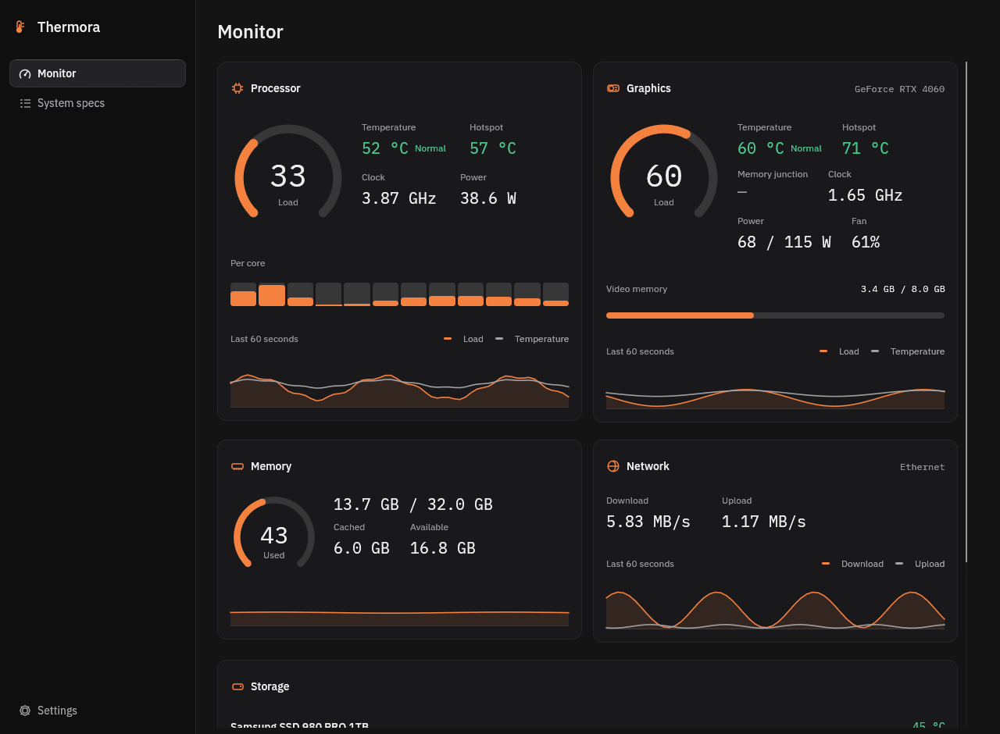
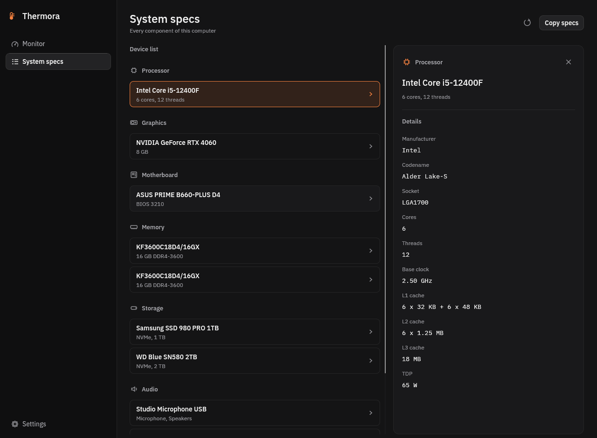
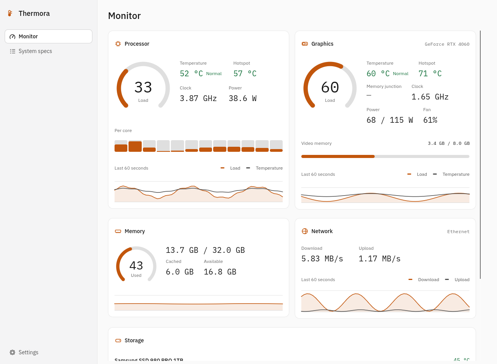
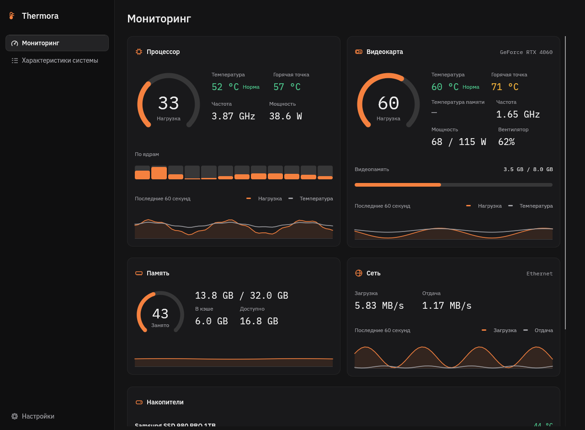

# Thermora

A small hardware monitor for Windows and Linux. It shows the load, temperature, clock and power of the processor and graphics card, memory use, network speed and the activity and temperature of every drive, live, with a 60 second chart for each. A System specs page lists every component of the computer with its exact model.



## What it does

- **Monitor.** Cards for the processor (a ring gauge for load, temperature and the hottest core, clock, power, a strip of per-core load), the graphics card (load, temperature, hotspot and memory junction, video memory, clock, power against the limit, fan), memory (used, cached, available), network (download and upload with automatic units) and every drive (activity, read and write rates, temperature, free space per volume). Everything refreshes once a second, numbers glide, and the charts show the last 60 seconds. Temperatures are coloured only by comfort band (normal, warm, hot; the thresholds per vendor are documented in `src/model.rs`).
- **Dashes, never fake zeros.** A reading a device cannot give shows a dash, and its tooltip says why ("Needs CPU temperature access", "Not reported by this device", and so on).
- **System specs.** A device list grouped like a PC builder's sheet: processor, graphics, motherboard, memory (one row per module), storage (one row per drive), audio, network. Click a row and a details panel slides in on the right: cores, caches, codename and socket; video memory, driver, clocks, power limit and PCIe link; board, chipset and BIOS; each module's part number, speed and voltage; each drive's bus, health, temperature, wear and data written; audio devices and network adapters. Escape or a second click closes it. **Copy specs** puts a plain-text summary on the clipboard (no serial numbers and no addresses).
- **Settings.** Theme (system, light, dark), language (English, Russian, Ukrainian), start with the system, CPU temperature access, support and about.
- **Tray.** With "Start with the system" on, Thermora starts hidden in the tray and the tooltip shows the CPU and GPU temperature; closing the window keeps it there. With it off, closing the window exits. Thermora is two small parts in one program: the tray part has no window, and the window starts when you open it and ends when you close it.







## CPU temperature on Windows

Windows does not give apps the processor's temperature sensors; reading them needs a kernel driver. Thermora does it like this, and it works without it:

- Until you enable it, the processor card shows a dash for temperature and power and a dismissible banner with **Enable CPU temperature**. Everything else works.
- **Enable** opens a dialog that names the driver and what is installed. If you agree, Windows asks for permission **once**. Thermora then downloads the official **PawnIO** installer (by namazso, https://pawnio.eu), checks its SHA-256 against a value built into Thermora, and only then runs it; a file that does not match is deleted and never started. It also puts the small helper `ThermoraSensor.exe` into `C:\Program Files\Thermora` (a folder only administrators can write to) with the signed PawnIO `IntelMSR` module, and registers a scheduled task "Thermora Sensor" that runs the helper with the highest privileges for your user.
- From then on Thermora starts the helper through that task with no more prompts. The helper only **reads** a few Intel registers (package and core temperature, package energy) and writes one text line per second to a named pipe that only your user can open. It has no commands and writes nothing. It leaves by itself a minute after the last reader goes away.
- The helper has its own version. When a Thermora update ships a different helper, Settings offers **Update sensor component**, which needs one more permission prompt; nothing changes silently.
- **Settings, CPU temperature access, Disable** removes the helper and its task. PawnIO stays installed; remove it under Windows Apps if you want.
- Intel processors only for now. AMD processors show a dash and a note.

Licences: PawnIO is GPL-2.0-or-later with an exception for programs that talk to it only through its device interface, which is all Thermora does; its modules are LGPL-2.1. Thermora ships no part of PawnIO.

Pinned files (official sources): PawnIO setup 2.2.0 (`github.com/namazso/PawnIO.Setup`) and the PawnIO modules release 0.2.12 (`github.com/namazso/PawnIO.Modules`).

## What needs what

| Reading | Windows | Linux |
|---|---|---|
| CPU load, clock | built in | built in |
| CPU temperature, hottest core | PawnIO + helper (Intel) | kernel hwmon, no root |
| CPU power | PawnIO + helper | RAPL, root only |
| NVIDIA GPU | NVML (and NvAPI for hotspot and memory junction) | NVML |
| AMD GPU | load and video memory only | amdgpu hwmon, no root |
| Memory modules | WMI | SMBIOS, root only |
| NVMe temperature and health | built in, no driver | hwmon (temperature) |
| Network, disks, board, BIOS, audio | built in | sysfs, procfs, DMI |

The sources of every number and what was measured are in `docs/SENSORS.md`.

## Privacy

Everything stays on your computer. Thermora never reads serial numbers, UUIDs, MAC addresses or your public IP. The local IPv4 address appears on the specs page only and is left out of **Copy specs**.

## Support

Thermora is free. If it is useful, you can support its development: https://donatello.to/MicsGame (a QR code is in Settings).

## Build

```
cargo build --release
cargo test
cd sensor && cargo build --release
```

Windows with the GNU or MSVC toolchain; Linux needs `libgtk-3-dev libayatana-appindicator3-dev libxkbcommon-dev libwayland-dev libx11-dev libxcb1-dev libxdo-dev libudev-dev`. The release zip contains `Thermora.exe` and `ThermoraSensor.exe` side by side.

`Thermora --demo` runs with plausible fake readings and a fake hardware list (set `THERMORA_DATA_DIR` to a temporary folder first). `Thermora --probe [--seconds N]` prints this computer's readings once a second.

Environment variables for tests and screenshots: `THERMORA_DATA_DIR`, `THERMORA_DEMO=1`, `THERMORA_LANG`, `THERMORA_THEME`, `THERMORA_DEMO_NOACCESS=1` (a test folder only: the demo as it looks before CPU temperature is enabled), `THERMORA_SHOT_DIALOG=1`, `THERMORA_SHOT_SELECT=<row>`, `THERMORA_PF_DIR` (a test folder only: a stand-in for the Program Files folder) and `THERMORA_SCROLL`.

## Linux

The Linux build was written against the kernel documentation and checked by CI; it was not run on a real Linux machine by the author. The tray icon needs GTK 3 and libayatana-appindicator3 (GNOME also needs the AppIndicator extension). Without a tray host the window still works.

## Credits

The NvAPI thermal sensor ids and layout, and the Intel register meanings, were learned from the open-source [LibreHardwareMonitor](https://github.com/LibreHardwareMonitor/LibreHardwareMonitor) (MPL-2.0); no code was copied.
